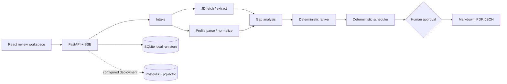

# PlacementGap

PlacementGap compares a student's academic record with a job description, scores skill gaps deterministically, and proposes a prerequisite-aware learning schedule inside a stated weekly hour budget. Every profile evidence quote retains a source document and exact character span.

## Run locally on Windows

This checkout was set up with the bundled Python 3.12 and Node runtimes. The project dependencies are installed in `.venv` and `web/node_modules`.

```powershell
.\start.ps1
```

The UI opens at [http://localhost:5173](http://localhost:5173), and the API is available at [http://localhost:8000/docs](http://localhost:8000/docs). To repeat installation on this machine, run `.\setup.ps1`. On another machine, install Python 3.11+, Node 20+, and pnpm, then run `python -m venv .venv`, `pip install -e ".[dev]"`, and `pnpm --dir web install`.

The local website can analyze pasted profile/JD text without credentials. It also accepts PDF, DOCX, TXT, and Markdown profiles, fetches HTTPS job pages when robots.txt permits, and has a small bundled role/company example corpus for offline role search. Runs and their approval state are persisted in `outputs/app/runs.sqlite3`. The report is generated after the user approves the proposed plan.

## Render deployment

The root `Dockerfile` builds the React frontend and serves it with the FastAPI backend from one Render web service. The included `render.yaml` selects fixture mode, enables secure session cookies, generates a session signing secret, and checks `/api/health`.

The free Render service uses local SQLite on an ephemeral filesystem. Accounts, runs, and reports can be cleared when the service restarts or redeploys. Use persistent storage or migrate the app data to a managed database before relying on this deployment for real users.

## Email and password accounts

Create an account or sign in with an email address and password from the login page. Passwords are stored as salted scrypt hashes; signed-in sessions use a signed, HTTP-only, seven-day cookie. A new account cannot sign in until the person opens a single-use email verification link. Verification links expire after 30 minutes, and resends are rate-limited. Each successful password sign-in triggers a security notification to the verified address; a temporary mail-provider failure is logged without locking the user out.

Email delivery is required to register accounts. Configure `PLACEMENTGAP_RESEND_API_KEY` and `PLACEMENTGAP_MAIL_FROM` in Render's service settings (or in `.env` locally). The API key must be a Resend send-only key; the sender address must belong to a domain verified in Resend (for example, `PlacementGap <no-reply@your-domain.example>`). This app sends messages through Resend's HTTPS API, which works on Render Free where outbound SMTP ports are blocked. Set `PLACEMENTGAP_PUBLIC_URL` to the public website address so links point to the correct site. Never commit the API key or add it to the frontend. Use a separate development key/sender for local testing if desired.

For the Render service, use `https://placementgap.onrender.com` as `PLACEMENTGAP_PUBLIC_URL`. Copy `.env.example` to `.env` for local development, set `PLACEMENTGAP_SESSION_SECRET` to a random value to keep sessions valid across API restarts, and set `PLACEMENTGAP_HTTPS=true` when serving over HTTPS. Existing accounts from the older schema must verify their address once before signing in. Account and run data are stored locally in SQLite.

### Google and GitHub sign-in

The login and account-creation screen also supports Google Identity Services and GitHub OAuth. Google ID tokens are verified by the API, and GitHub's OAuth state is checked before the API reads the user's verified email. Both providers can securely connect to an existing PlacementGap account when the provider proves ownership of the same email. Google sign-in requires a verified Gmail or Google Workspace address. GitHub asks only for public profile and email (`read:user user:email`) and does not retain its access token.

Configure Google in Google Cloud Console: create an OAuth client with application type **Web application**, set up the OAuth consent screen, and add `https://placementgap.onrender.com` under **Authorized JavaScript origins**. For local testing, add `http://localhost:5173` and `http://127.0.0.1:5173`. This Google button uses the Google Identity Services JavaScript callback, so it does not need an Authorized redirect URI or a Google client secret. Add the resulting client ID to Render as `PLACEMENTGAP_GOOGLE_CLIENT_ID`.

Configure GitHub under **Settings → Developer settings → OAuth Apps → New OAuth App**. Use `https://placementgap.onrender.com` as the homepage and `https://placementgap.onrender.com/api/auth/oauth/github/callback` as the Authorization callback URL. Add its client ID to Render as `PLACEMENTGAP_GITHUB_CLIENT_ID`, then generate a client secret and add it as `PLACEMENTGAP_GITHUB_CLIENT_SECRET`. GitHub users need at least one verified email address. For local GitHub testing, create a separate OAuth App with homepage `http://localhost:5173` and callback `http://localhost:5173/api/auth/oauth/github/callback`, then temporarily use those local credentials in `.env`.

In Render, open the `placementgap` web service → **Environment**, add the three variables above, save, and redeploy. Keep the GitHub client secret server-side; never put it in the React code or commit it. Google's client ID is public and is served to the browser so the official Google button can initialize. These sign-in methods authenticate a Google/GitHub account only; PlacementGap does not access Gmail or GitHub repositories.

## Optional model extraction

Without an API key the app uses its deterministic offline extractor. To enable LiteLLM JD extraction, set a provider key and model names in the environment before starting the API. For OpenAI, for example:

```powershell
$env:OPENAI_API_KEY = "your-key"
$env:PLACEMENTGAP_MODEL_FAST = "gpt-4o-mini"
$env:PLACEMENTGAP_MODEL_STRONG = "gpt-4o"
```

The extractor reads its versioned system prompt from `agent/prompts/jd_extract.v1.md`; the JD is passed separately as fenced untrusted user data. Extracted spans and ontology IDs are validated before use. Failed attempts fall back to deterministic extraction and mark the run degraded. The schedule and its arithmetic always remain Python deterministic operations.

## Services and checks

`docker compose up -d` starts PostgreSQL 16 with pgvector, the API container, Vite, and Jaeger on systems with Docker Compose installed. The locally verified Windows workflow uses SQLite for persistent run state so Docker is optional. Run project checks with:

```powershell
.\.venv\Scripts\python.exe -m pytest
.\.venv\Scripts\python.exe -m evals.runner --split dev
pnpm --dir web build
```

The frozen heldout split requires the explicit flags `--heldout --confirm`. Rebuild bundled skill and evaluation fixtures with `python -m ontology.build_taxonomy` and `python -m evals.generate_data`.

### Ablation snapshot

The current ablation command runs each named variant through the offline fixture pipeline. The pipeline variants are not yet behaviorally isolated, so these rows are a wiring smoke check and must not be used to infer causal model or ontology effects.

<!-- ABLATIONS:START -->
| Variant | Success rate | Plan validity | Cost/run | P95 latency |
|---|---:|---:|---:|---:|
| full | 0.583 | 1.000 | $0.000 | 1 ms |
| single_prompt_baseline | 0.583 | 1.000 | $0.000 | 1 ms |
| no_ontology | 0.583 | 1.000 | $0.000 | 1 ms |
| no_critic | 0.583 | 1.000 | $0.000 | 1 ms |
| no_memory | 0.583 | 1.000 | $0.000 | 1 ms |
| cheap_model_only | 0.583 | 1.000 | $0.000 | 1 ms |
| no_deterministic_solver | 0.583 | 1.000 | $0.000 | 1 ms |
<!-- ABLATIONS:END -->

## Architecture



## Known limitations

- The checked-in role search uses a small offline fixture corpus. It is not a live search provider.
- The document parser extracts text from PDFs and DOCX files but does not implement OCR for scanned PDFs or layout-aware multi-column reconstruction.
- Model-backed JD extraction uses LiteLLM when configured. Profile parsing, normalization, gap verdicts, and critiques currently use deterministic fixture logic; the critic node does not issue an LLM call yet.
- Local durability is implemented with SQLite. PostgreSQL/pgvector, LangGraph checkpointing, profile reuse, and semantic cache services are provisioned in Compose/schema but are not yet wired to the runtime repository.
- The evaluation dataset is synthetic. The existing judge calibration and chaos commands emit fixture results and are not human-validated measurements. The frontend labels the evaluation source accordingly.
- No public cloud deployment target or hosting account was supplied. `start.ps1` serves the complete website on this machine's localhost; making it publicly reachable needs a chosen hosting destination and its credentials.
